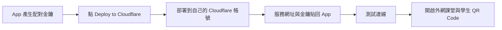

# 課堂互動站 Cloudflare 外網中繼

供商店版課堂互動站使用的獨立部署範本。每個部署同時服務一堂課，不含 App 原始碼、學生資料或任何實際金鑰。

## 不使用終端機的設定

1. 登入 Cloudflare 與 GitHub／GitLab。
2. 在 App 產生 64 位配對金鑰。
3. 點公開範本的 Deploy to Cloudflare 按鈕，授權複製儲存庫，在部署表單將金鑰填入 PAIRING_KEY secret。
4. 部署完成，將 workers.dev 服務網址與相同金鑰貼回 App，測試連線後開啟外網課堂。

### 設定流程圖

### 部署畫面要填什麼？

| 欄位 | 設定 |
| --- | --- |
| GitHub 儲存庫 | 複製到自己的帳號；可自行命名 |
| Worker 名稱 | 可保留 classroom-relay，或自訂 |
| Build command | 留空（此專案不需要編譯） |
| Deploy command | npm run deploy |
| PAIRING_KEY | 貼上 App 產生的金鑰，設定為 Secret |

若部署表單未顯示金鑰欄位，部署後到該 Worker 的 Settings → Variables and Secrets，新增類型為 Secret、名稱為 `PAIRING_KEY` 的項目，填入金鑰後部署更新。不要把金鑰寫進 GitHub 檔案、Issue 或截圖。

取得的服務網址形如 `https://classroom-relay.你的子網域.workers.dev`。App 使用服務網址；學生使用開課後產生的邀請網址／QR Code。不要將配對金鑰給學生。

### 費用與資料歸屬

每位老師部署到自己的 Cloudflare 帳號，使用各自額度。範本維護者只提供原始碼，不會因此取得其他老師的 Cloudflare 帳號、金鑰或學生資料。GitHub 存放程式；學生課堂流量經過老師自己的 Worker 與 Mac。

可先使用免費方案；實際額度與超額行為以 [Cloudflare 官方說明](https://developers.cloudflare.com/durable-objects/platform/pricing/) 為準。不要為了完成設定而自行升級付費方案。此範本不提供共用伺服器，也不保證服務可用率。

### 連線失敗時

- 確認填的是 HTTPS 服務根網址，沒有 `/invite/` 路徑。
- 確認 Cloudflare Secret 與 App 配對金鑰一致，且已部署更新。
- 確認 Mac 沒有睡眠、App 已開啟本機課堂，網路允許 HTTPS / WSS。
- 配額用盡時，查看自己的 Cloudflare 儀表板；不要把金鑰貼到公開討論區。
- 結束上課請在 App 停止外網課堂。每個服務同時只支援一堂課。

學生填寫後是否直接投影，由 App 的自動投影設定控制，與中繼部署分開設定。

## 本機驗證與維護

Node.js 22 以上，`npm ci`，將 `.dev.vars.example` 複製成 `.dev.vars` 並設定測試用 PAIRING_KEY，`npm run dev`。正式部署執行 `npm run deploy` 並使用 Cloudflare Secrets 設定 PAIRING_KEY。本機 `.dev.vars` 永不提交。

範本使用 SQLite-backed Durable Objects，支援免費 Workers 方案。CPU、請求、運算時間等限制仍適用。不能保證不限量使用。

## 邊界

- 老師以 WSS 主動連線；學生以 HTTPS 加入。Mac／App 必須保持運作。
- 僅轉送學生頁、加入課堂、回答與圖片；沒有公開老師管理、投影、匯出及本機檔案路由。
- 每張圖片最多 2 MB，ZIP 不開放；最多 8 個同時處理中的請求、單 IP 每分鐘 240 次請求、15 秒回應逾時。
- 邀請使用兩組隨機 UUID 組成的權杖；配對金鑰獨立，不給學生。每堂 8 小時到期，停止後失效。
- 回答只暫存於轉送中的記憶體；Durable Object 只存到期時間與隨機授權資訊。停課／到期清除。
- 關閉 Worker observability，避免將邀請與連線 URL 寫入應用程式存取日誌。平台仍依其政策處理流量資訊。
- 學生與服務、服務與 Mac 分別使用 TLS，不是端對端加密。
- HTTP 頁面仍屬單一 Worker origin。一個服務只供一堂課；切換邀請會清除該 origin 的學生工作階段。

官方參考：
- https://developers.cloudflare.com/workers/platform/deploy-buttons/
- https://developers.cloudflare.com/durable-objects/best-practices/websockets/
- https://developers.cloudflare.com/durable-objects/platform/pricing/
